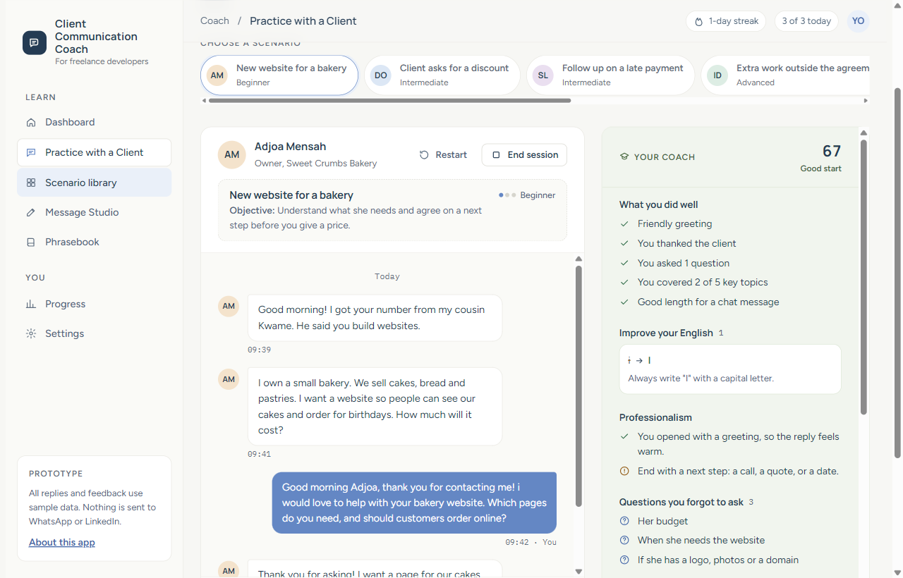
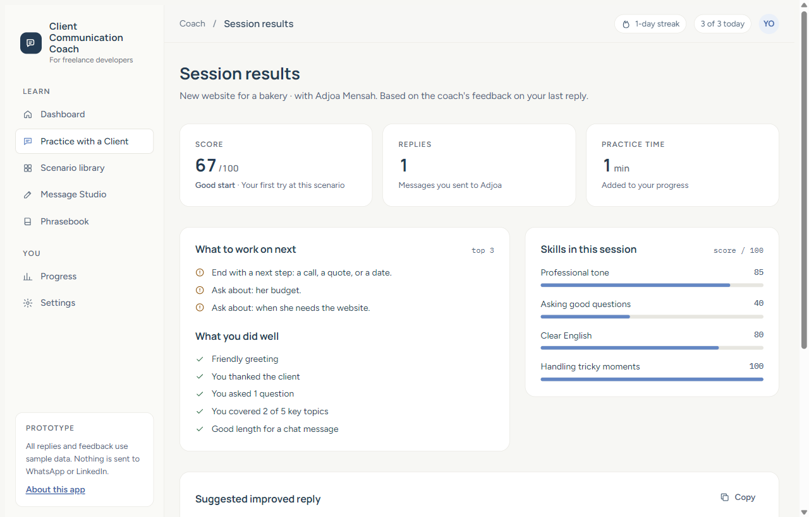
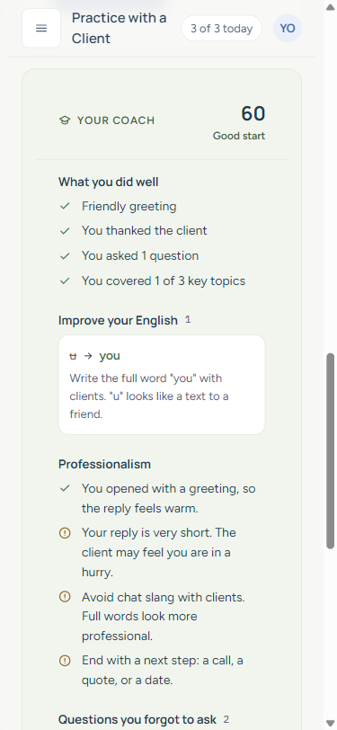
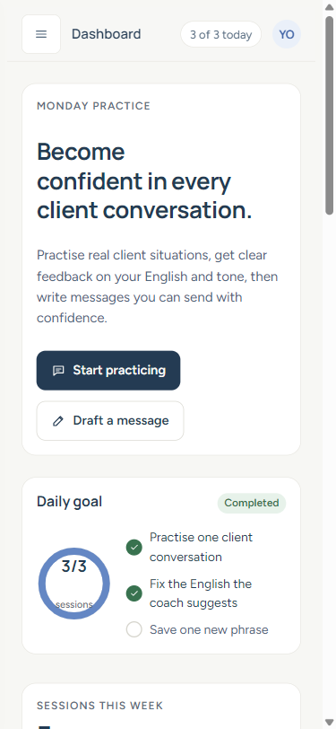
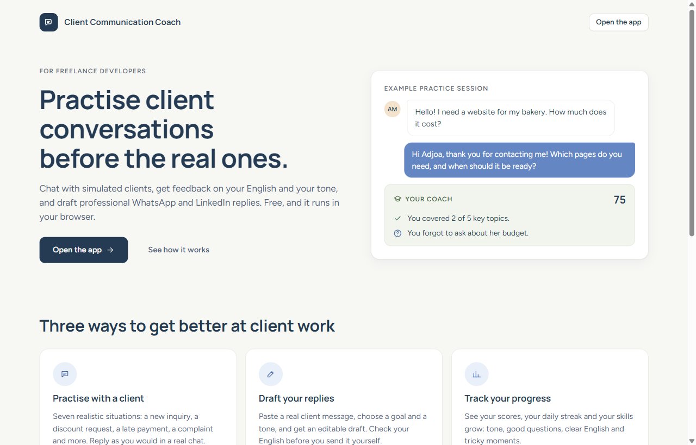

# Client Communication Coach

A web app that helps freelance developers practise client conversations, improve their professional English, and draft replies for WhatsApp and LinkedIn.

**Live demo:** https://mustypro137.github.io/client-communication-coach/ (landing page) · [open the app directly](https://mustypro137.github.io/client-communication-coach/app.html)

> **Prototype:** the "AI" is simulated. Client replies are scripted, and the coach's feedback comes from simple, transparent rules (greeting, thanks, questions asked, common grammar mistakes). It does not understand every possible reply.

## Screenshots





<p>
  
  
</p>



## Features

- **Dashboard:** daily goal, streak, your stats, scenarios with your latest scores, and a recommended next exercise.
- **Practice with a Client:** ten realistic scenarios (new inquiry, discount request, late payment, extra scope, unrealistic deadline, complaint, follow-up after no reply, asking for a review, telling a client you need more time, saying no to a project). Chat with a simulated client, then get coaching on your English, tone, and the questions you forgot to ask. Try again as often as you like.
- **Scenario library:** all scenarios as cards, with the skill each one trains and your last score. Filter by level, or by new and practised.
- **Session results:** press End session to see your score (compared with last time), skill bars, the top 3 things to fix, and the recommended next scenario.
- **Message Studio:** paste a client message, choose a goal and tone, and get an editable, template-based draft. It explains why the draft works, lists questions to clarify, and can check your edited English.
- **Phrasebook:** professional phrases with plain-English meanings. Search, filter, copy and save your favourites.
- **Progress:** practice minutes this week, skill scores, your most common English mistakes (only the mistake is saved, never your reply) and session history, saved in your browser.
- **Settings:** daily goal, defaults, your English level (beginner explanations use simpler words and an example; advanced ones are short and use grammar terms), a reset button for your progress, and **download / load your progress as a file** to move it to another device (sessions and saved phrases; loading adds, never deletes).

Messages are **never sent automatically**. You copy the reply and send it yourself.

## Install it

It is an installable web app (PWA): it opens full screen from your home screen, and works offline after your first visit.

- **Android, Windows, Mac (Chrome or Edge):** press **Install the app** on the landing page, or use the install icon in the address bar.
- **iPhone and iPad:** open the site in Safari, tap **Share**, then **Add to Home Screen**.

## Run it locally

The app uses ES modules, so it must be opened through a local server (double-clicking the HTML files will not work).

```bash
# Option 1: Python
python -m http.server
# then open http://localhost:8000 (landing page)
# or http://localhost:8000/app.html (the app)

# Option 2: VS Code
# install the "Live Server" extension and click "Go Live"
```

No install or build step is needed.

## Run the tests

With [Node.js](https://nodejs.org) 22 or newer:

```bash
npm test
```

The tests check the grammar rules, the coach's scoring, the progress calculations, every practice scenario (including that each suggested reply passes the coach's own rules) and the offline file list. They use Node's built-in test runner, so there is nothing to install.

## Project structure

```
index.html        landing page for new visitors
manifest.webmanifest  app name, icons and colours for installing
sw.js             service worker: saves the app's files so it works offline
icons/            app icons for the home screen
app.html          the app: page structure (8 screens)
style.css         all styles; colours and spacing are CSS variables
js/
  main.js         entry point: navigation, settings, start-up
  utils.js        shared helpers (icons, toast, copy to clipboard)
  data.js         practice scenarios and phrases
  state.js        the shared app state
  progress.js     saved practice sessions, streak, common mistakes and Progress screen
  english.js      grammar rules shared by the coach and Message Studio
  dashboard.js    dashboard screen
  practice.js     practice chat screen
  coach.js        the simulated coach (scores a reply)
  results.js      session results screen
  library.js      scenario library screen
  studio.js       Message Studio templates
  phrasebook.js   phrasebook screen
  pwa.js          registers sw.js and shows the Install button
server/           optional Cloudflare Worker that calls Claude (tested, not deployed or connected)
tests/            automated tests for the app's logic (npm test)
docs/screenshots/ images used in this README
```

## Privacy

- No accounts, no tracking. Nothing you type leaves your browser.
- Practice progress, saved phrases and settings are stored in your browser's `localStorage`. This is **not** encrypted, so don't store sensitive information. You can reset your progress in Settings. A downloaded progress file is a plain, unencrypted file too: keep it somewhere private.
- Pasted client messages are never saved.

## Built with

HTML, CSS and vanilla JavaScript. No frameworks or dependencies. Tests use Node's built-in test runner.

## What I learned

- **Splitting code by job.** One file per screen, plus small files with no screen code (`english.js`, `coach.js`, `progress.js`). Those are the ones I can test without a browser.
- **Testing.** A test that checks the landing page's example score caught that the page and the real coach could disagree.
- **Accessibility.** Contrast of 4.5:1 in light and dark mode, 44px touch targets on phones, labels for every field, keyboard focus that stays inside the open phone menu, and screen-reader announcements.
- **Responsive layout.** Checking every change at desktop width and at 375px.
- **Privacy and honesty.** Only progress and settings are saved, pasted client messages never are, and rule-based feedback is labelled "Template-based", not presented as AI.
- **Keeping secrets out of the browser.** `server/` shows how a real AI call would work: the API key stays on a small server, with a passcode, input limits and safe error messages.

## Roadmap

- Optional real AI: `server/` already has a tested English check with Claude; it would need deploying and connecting again (see server/README.md).
